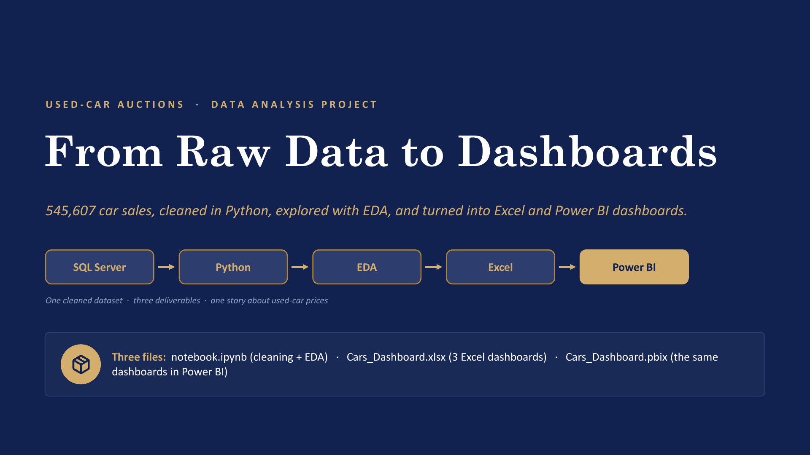
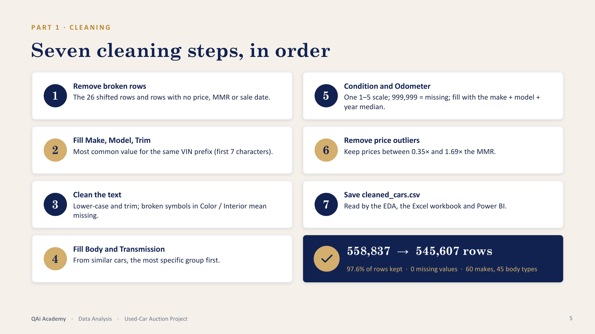
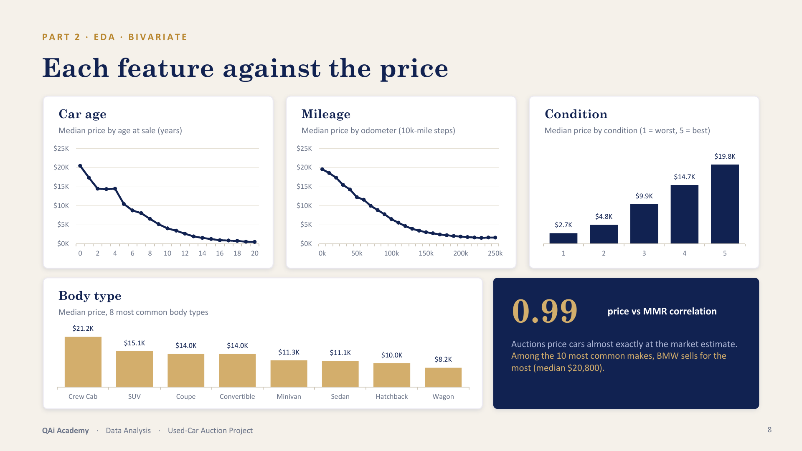
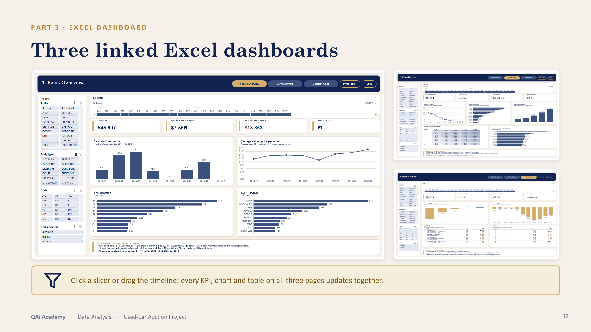
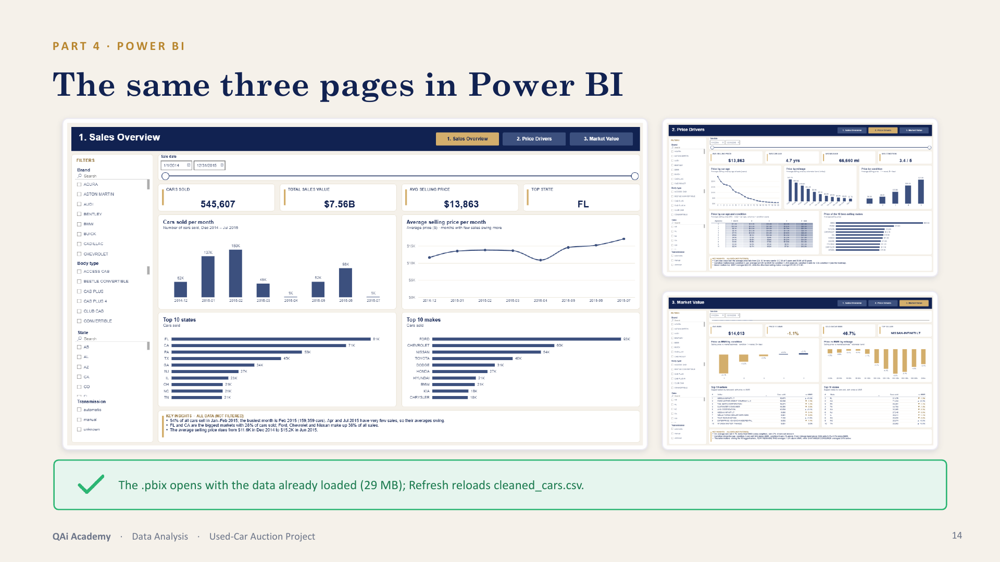

# Used-Car Auction Analysis: From Raw Data to Dashboards

By **Fares Ayman Gaber** · [LinkedIn](https://www.linkedin.com/in/fares-ayman)

An end-to-end data analysis project on **558,837 used-car auction sales**. The raw data comes from a SQL Server table. It is cleaned and explored in a Python notebook, then turned into two interactive dashboards, one in **Excel** and one in **Power BI**, that tell the same story with the same numbers.

**Tools:** SQL Server · Python (pandas, NumPy, Matplotlib, seaborn) · Excel (PivotTables, PivotCharts, slicers, timeline) · Power BI (Power Query, DAX)



## How the project fits together

```
SQL Server                 notebook.ipynb            cleaned_cars.csv           Cars_Dashboard.xlsx
MotoDB.dbo.VehicleSales ─► cleaning + EDA ─────────► 545,607 rows ────────────► (Excel dashboard)
558,837 rows × 17 cols     (Python, pandas)          18 columns          └────► Cars_Dashboard.pbix
                                                                                 (Power BI dashboard)
```

## What's in this folder

| File | What it is |
|---|---|
| `notebook.ipynb` | **Python notebook.** Loads the data from SQL Server, cleans it in 7 steps, saves `cleaned_cars.csv` and runs the EDA. |
| `cleaned_cars.csv` | **Cleaned dataset:** 545,607 rows × 18 columns. Both dashboards are built on it. |
| `Cars_Dashboard.xlsx` | **Excel dashboard:** 3 linked dashboard pages, a Pivot Tables sheet and a Data sheet. |
| `Cars_Dashboard.pbix` | **Power BI dashboard:** the same 3 pages, saved with the data. |
| `Cars_Project_Presentation.pptx` | **PowerPoint presentation:** 18 slides covering the whole project. |
| `README.md` | This file. |
| `images/` | Five slides from the presentation, shown in this README. |

## The data

Each row is one car sold at a wholesale auction, mostly between **Dec 2014 and Jul 2015**. The sales cover 34 US states plus 4 Canadian provinces, which account for about 1% of the rows.

| Group | Columns |
|---|---|
| The car | `Year`, `Make`, `Model`, `Trim`, `Body`, `Transmission`, `VIN` |
| Its condition | `ConditionValue` (1–5), `Odometer` (miles), `Color`, `Interior` |
| The sale | `Seller`, `State`, `SaleDate` |
| The prices | `MMR` (Manheim Market Report: the market's price estimate) and `SellingPrice` |

## 1. Data cleaning (`notebook.ipynb`)

| # | Step | What it does |
|---|---|---|
| 1 | Remove broken rows | 26 rows were shifted one column ("sedan" in Transmission) and had no price or date. Dropped, together with rows missing the price, MMR or sale date. |
| 2 | Fill Make, Model, Trim | About 1.8–1.9% were missing. Filled with the most common value for the same VIN prefix (its first 7 characters identify the car). Any Trim still missing takes the most common trim of the same make + model. |
| 3 | Clean the text | Lower-cased and trimmed ("Ford" = "ford"). Broken symbols in Color / Interior mean missing. |
| 4 | Fill Body and Transmission | Transmission was 11.7% missing and Body 2.4%. Each gap takes the most common value of the most similar cars (make + model + trim first, then broader groups), only when the group is big enough and agrees. Leftovers: Transmission = "unknown", Body rows dropped. |
| 5 | Condition, Odometer, Color, Interior | Two condition scales (1–5 and 11–49) became one 1–5 scale, and Odometer 999,999 is treated as missing. Missing Condition and Odometer values take the median of the same make + model + year. Missing Color and Interior become "unknown". |
| 6 | Remove price outliers | Kept cars sold for 0.35–1.69 × their MMR (about the 1st to 99th percentile). |
| 7 | Save | Writes `cleaned_cars.csv`. |

**Result:** 558,837 → **545,607 rows** (97.6% kept) and **0 missing values**.



## 2. Exploratory data analysis

- **Univariate:** summary statistics, distributions of price, mileage, car age and condition, and the most common makes, body types and transmissions.
- **Bivariate:** price against car age, mileage, condition, body type and make, and selling price against MMR.
- **Multivariate:** a correlation matrix, price by age for each body type, and price by age and condition.



## 3. Excel dashboard (`Cars_Dashboard.xlsx`)

- **3 linked pages:** *1. Sales Overview*, *2. Price Drivers* and *3. Market Value*.
- **Data sheet:** an Excel Table (`SalesData`) with the clean data plus helper columns (car age, condition score, mileage band, sale month, and more).
- **Pivot Tables sheet:** 14 PivotTables (P1–P14) on one shared PivotCache.
- **On every page:** KPI cards (GETPIVOTDATA), PivotCharts, and 4 slicers (Brand, Body type, State, Transmission) plus a sale-date timeline, connected to all 14 pivots. Page buttons and a key-insights box complete each page.
- **Design:** navy, slate, gold and cream, with rounded boxes.



## 4. Power BI dashboard (`Cars_Dashboard.pbix`)

- **Power Query** loads `cleaned_cars.csv` and adds 12 helper columns.
- **Data model:** a `Sales` table and a `Calendar` table (a relationship on the sale date).
- **20 DAX measures:** KPIs, price vs MMR, top lists, and colour rules.
- **The same 3 pages as Excel,** with synced slicers, a date-range slider, Top-N visuals, conditional colours and a heatmap.



## 5. Checking the numbers

| What | Checks | Result |
|---|---|---|
| Notebook | The notebook's stated findings, recomputed from `cleaned_cars.csv` | 18 / 18 match |
| Excel dashboard | KPIs, top-10 pivots, heatmap cells, sellers table, slicer and timeline filters vs pandas | 35 / 35 pass |
| Power BI dashboard | DAX measures, Power Query columns, top-10 lists, heatmap cells and filters vs pandas | 29 / 29 pass |

## Key insights

- **Typical price:** the median car sells for **$12,300**, and 79% sell for under $20,000.
- **Young, automatic cars:** 67% of the cars are 5 years old or less, and 96% are automatic.
- **Condition matters at every age:** at 5 years old, a car in condition 5 sells for about **4×** one in condition 1 ($18,000 vs $4,600 median).
- **Age and mileage:** prices fall steadily with age and miles, and the two move together (correlation 0.79).
- **Body and make:** SUVs and crew cabs keep their value best (at 10 years: crew cab $8,700 vs sedan $3,400). BMW leads the common makes (median $20,800).
- **Close to market value:** cars sell **1.1% below MMR** on average, and 47% sell above it (price vs MMR correlation 0.99).
- **When and where:** 54% of sales happened in Jan–Feb 2015, with February the busiest month (159,359 cars). Florida and California account for 28% of all cars sold.
- **Most common makes:** Ford, Chevrolet and Nissan make up 38% of sales.

## How to use these files

- **Excel dashboard:** open `Cars_Dashboard.xlsx` in Excel for desktop. The slicers and the timeline filter all three pages.
- **Power BI dashboard:** open `Cars_Dashboard.pbix` in Power BI Desktop. The data is already inside.
  - **Refresh** reloads `cleaned_cars.csv` from the folder in the **DataFolder** parameter. To load it from this folder, set the parameter to this folder's path in *Transform data → Edit parameters*.
- **Notebook:** the first cells read the raw data from a SQL Server database (`MotoDB`, server `localhost\SQLEXPRESS01`). Change the connection string to your server, then run the notebook. Its output is already saved as `cleaned_cars.csv`.
  - Python packages: `pip install pandas numpy matplotlib seaborn plotly pyodbc`
- **Presentation:** open `Cars_Project_Presentation.pptx` in PowerPoint.

## Acknowledgements

A big thank you to **Instant Software Solutions**, and to my instructor and my mentor, for their guidance, patience and honest feedback throughout this project.

## Author

**Fares Ayman Gaber**: [linkedin.com/in/fares-ayman](https://www.linkedin.com/in/fares-ayman)
